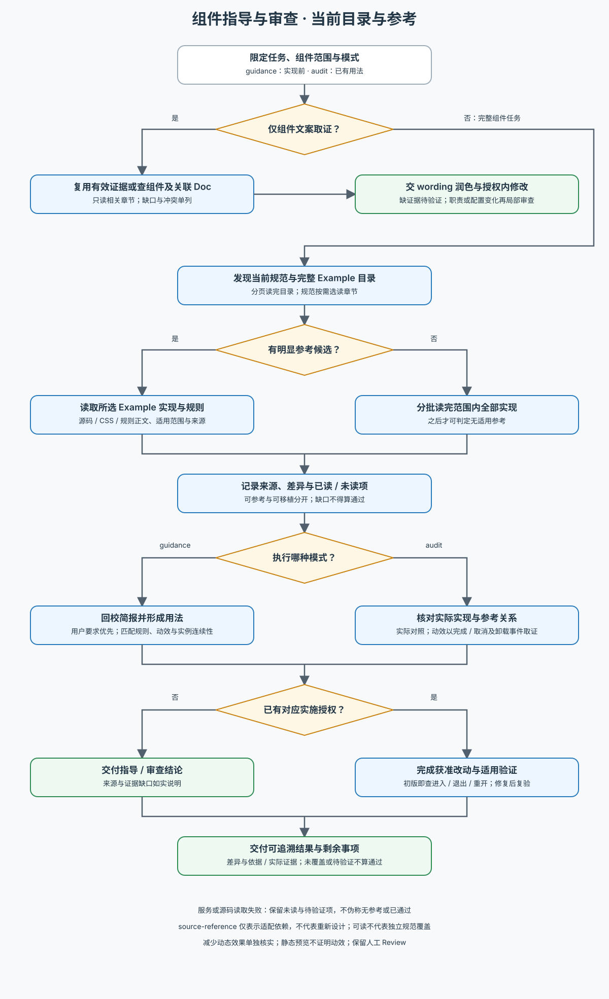

# AW Component Advisor

交付：**guidance** 输出经回校的实施依据、组件指导与验证计划；**audit** 输出可追溯的审查结论，已授权时完成修正与验证；局部文案取证向 wording 交付适用组件与关联 Doc 依据及缺口。

先读 [共用工作流](references/workflow.md)，再按模式读取：

| 当前任务 | 读取 |
| --- | --- |
| 实现前指导 | [guidance](references/guidance.md) |
| 审查现有用法 | [audit](references/audit.md) |
| wording 请求组件文案依据 | [局部取证](references/workflow.md#组件文案的局部取证)，只查相关组件与关联 Docs |
| 审查可交互 Dialog / Sheet 行为 | [动效专项](references/dialog-motion.md) |
| 调用知识 MCP | [知识访问契约](references/knowledge-access.md) |
| 维护来源优先级或交接规则 | [情境走查](tests/priority-scenarios.md) |

组件与关联 Doc 规范从当前本地 MCP 取得，精确 API 以当前 TypeScript 源码为准；本包不保存规则副本。未覆盖与待验证都不算通过。

