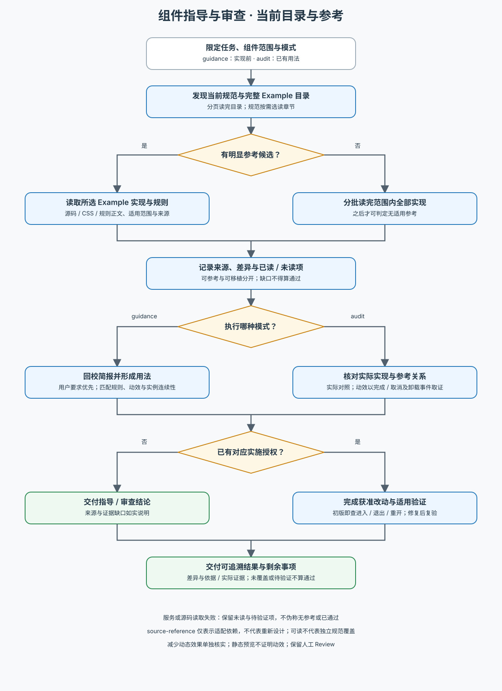

# AW Component Advisor

先读 [工作流](references/workflow.md)，按当前任务选择：

- **`guidance`**：从用户任务和当前规范形成组件用法与验证计划，核实真实 API，供当前执行者使用 AaronUI-Web 真实组件实现。
- **`audit`**：对现有界面、设计或实现取证，核对组件语义、组合和内部用法，交付可追溯结论；已授权修复时完成相应修改与验证。

需要规范或 Example 时读取 [知识访问契约](references/knowledge-access.md)。两模式通过手动启动的本地 MCP 读取同一源，规范覆盖与 Example 参考范围以当前服务目录为准。按工作流先读完整 Example 目录再选择实现参考，并遵循匹配 Example 明确规则、结构的默认采用与实际渲染对照要求，按适用维度记录差异与处理依据，公开 API 合法不能代替 Example 符合性判断；真正明确的用户要求优先，guidance 回校简报并标清来源和差异，AI 提案仅补足未覆盖部分；源码可参考与直接移植分别判断。未支持记为未覆盖，证据缺失记为待验证，不用旧 Reference 或内置规则兜底，不把两者算通过。

涉及可交互 Dialog / Sheet 时，guidance 明确动效接入与验证计划，初版立即检查进入、退出和再次打开，audit 以动态证据复核并完成获准修复；减少动态效果与静态预览分开记录。具体方法见工作流的动效专项，不预设库内置动画已正确接入。

本包只保存方法，不编辑组件规范或同步静态索引。精确 props、导出和行为以当前 TypeScript 源码核实。沿用已有范围与授权，纯审查不自动改产品或规则；后续变更改变组件用法时局部复核。不能替代相邻 Skill 的职责或越过人工 Review。

维护来源优先级或交接规则时，用 [情境走查](tests/priority-scenarios.md) 检查行为要求、明确文案、规则缺失、Example 差异处理、Dialog / Sheet 动效与必要 Review 的边界。

下图为共用知识入口、两模式与证据缺口的概览，执行细则由工作流维护。

