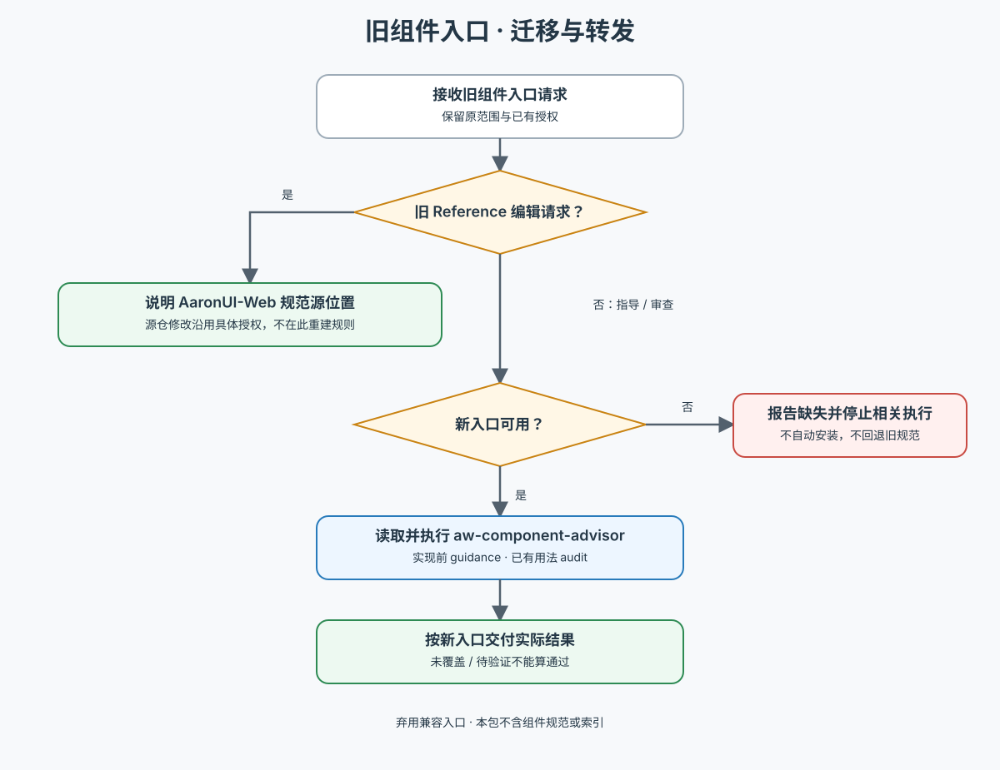

# AW Component Checker · 弃用兼容入口

按 [迁移工作流](references/workflow.md) 将旧调用转给 `aw-component-advisor`：实现前指导用 `guidance`，已有界面审查用 `audit`。从当前环境定位并读取新入口后实际执行，沿用原任务和授权；新 Skill 缺失时报告依赖，不恢复旧规则。

旧编辑模式的规范维护已移至 AaronUI-Web 源项目。本入口没有组件 Reference、索引、规则副本或知识兜底；本轮 `component/dialog` 覆盖及证据判断由新入口维护。其他资源不能因旧名称曾支持而算通过。

保留旧名称供安装与调用迁移；不作为活跃组件能力入口。

下图概览转发与旧编辑请求的迁移分支。

