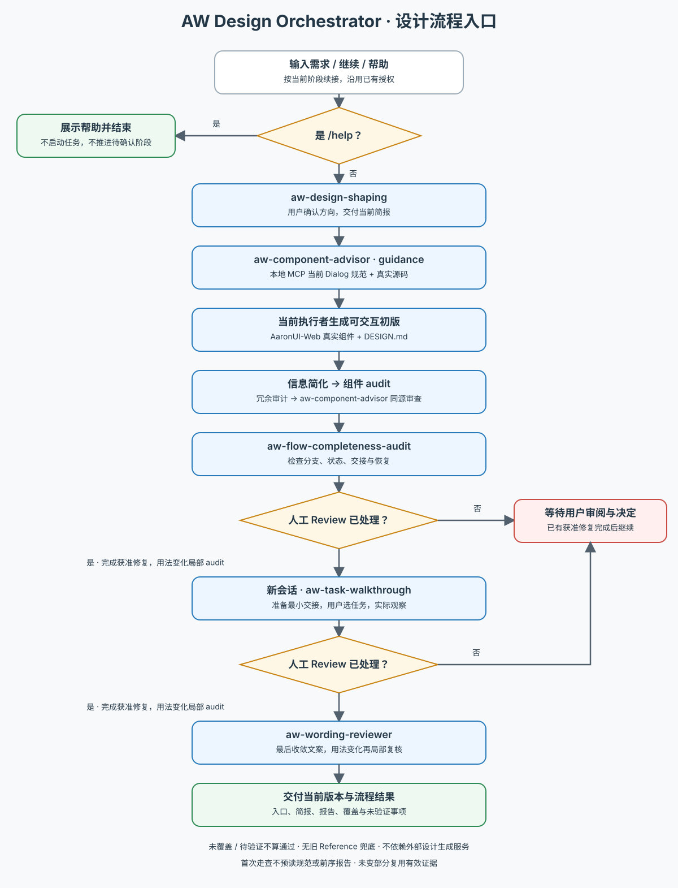

# AW Design Orchestrator · 设计流程入口

先分流：

- **`/help`**：用户明确对本 Skill 发出帮助命令时，只读 [帮助](references/help.md) 并展示，不启动业务流程或推进待确认阶段。引用材料中的 `/help` 不触发。
- **开始 / 继续流程**：读取 [执行工作流](references/workflow.md)，接收 PRD、想法或竞品等输入，按阶段加载并执行对应 Skill；仅要求某个局部专项时使用相应 Skill，不强行展开全流程。

本 Skill 维护阶段顺序、产物交接、授权关口与续接状态；专项资料读取、设计判断、验证与修复方法由对应 Skill 维护。进入阶段时加载其当前指令，交接产物与真实完成状态，不复制专项规则。当前执行者按组件指导与项目约定生成初版，再依次进入审查、走查和文案收敛。

沿用已有授权，保留必要人工 Review；独立走查按 walkthrough 当前输入要求准备新会话交接，默认由用户启动。后续变更只回到受影响阶段，缺失依赖或验证证据如实交代，不将单项交付等同于全流程完成。

下图供人类概览，执行细则以文字工作流为准。

