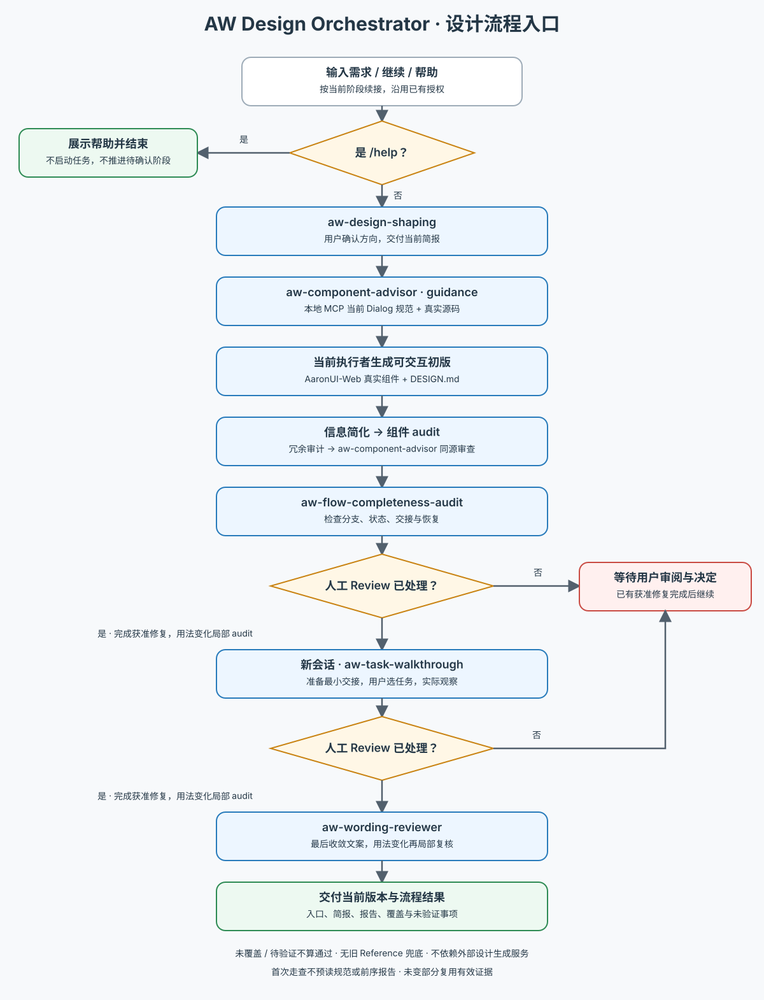

# AW Design Orchestrator · 设计流程入口

先分流：

- **`/help`**：用户明确对本 Skill 发出帮助命令时，只读 [帮助](references/help.md) 并展示，不启动流程或推进待确认阶段。
- **开始 / 继续流程**：读取 [执行工作流](references/workflow.md)，按阶段加载并执行对应 Skill；仅要求局部专项时直接使用相应 Skill。

本 Skill 只维护阶段顺序、产物交接、授权关口、变更回流与续接状态；专项规则由对应 Skill 维护，不复制。

