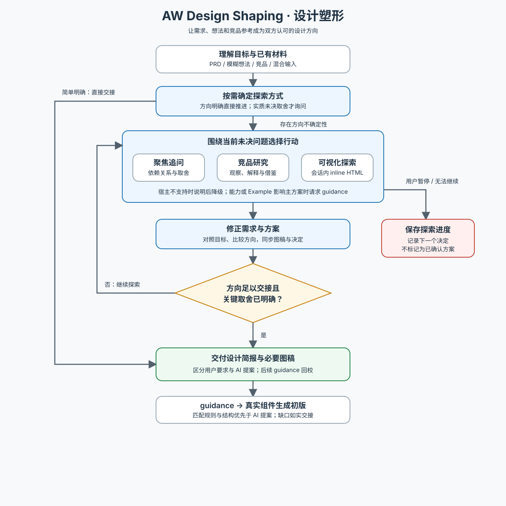

# AW Design Shaping · 设计塑形

交付：当前设计简报、必要图稿与未决项，供组件指导与初版生成使用。

先读 [工作流](references/workflow.md)，按当前问题选择追问、研究或可视化，不要求先补成 PRD。

| 当前任务 | 按需资料 |
| --- | --- |
| 给出竞品地址、产品名，或需要外部参照 | [竞品研究](references/competitor-research.md) |
| 需要线框图、布局对比或低保真交互消除分歧 | [可视化对齐](references/visual-alignment.md) |
| 维护本 Skill、核对借鉴方法的边界 | [方法来源与取舍](references/sources.md) |

关键取舍由用户决定，局部方案由 AI 先提出；简单明确任务直接提炼方向交接。用户明确要求与 AI 提案分开标注，探索原型不进入正式业务代码。

