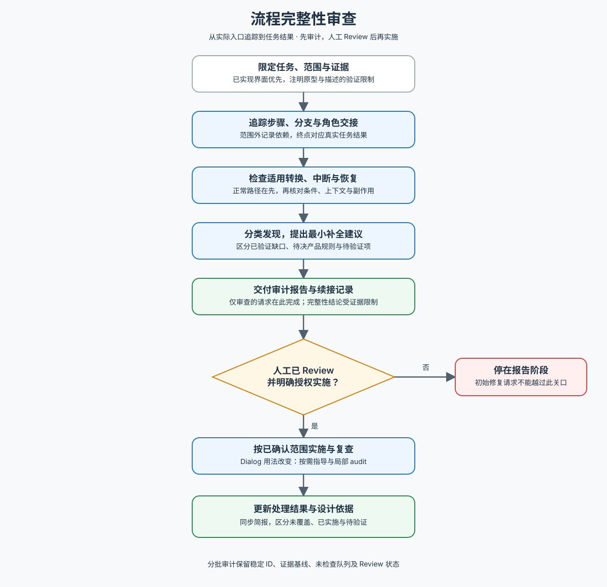

# 流程完整性审查

交付：流程完整性审计报告与待审事项；人工 Review 授权后完成选定补全与复查。

先读 [工作流](references/workflow.md)。完整审计或需要跨上下文续接时使用 [审计记录](references/audit-record.md)；维护方法时读 [来源与取舍](references/sources.md)。

**报告交付后必须等待人工 Review，即使初始请求已包含修复。**

