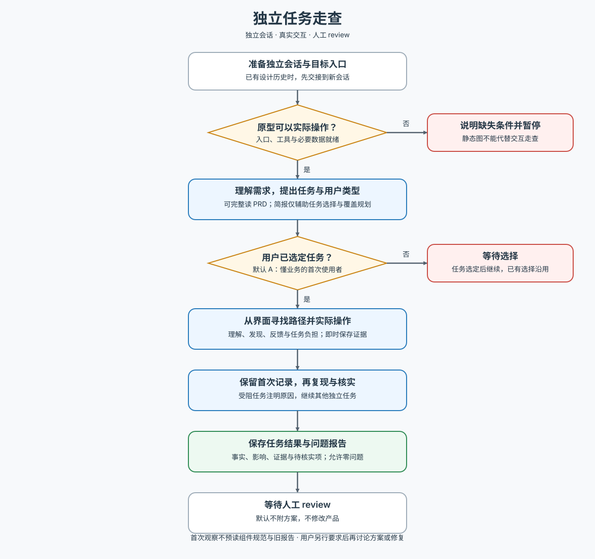

# AW Task Walkthrough · 独立任务走查

交付：用户选定任务的走查观察与问题报告，等待人工 review。

执行前读取 [工作流](references/workflow.md)。在独立新会话中实际操作可交互原型或产品；静态图不能代替走查。候选任务和用户类型（默认 A：懂业务、首次使用）由用户选定。默认只报告问题，不提供方案或修改产品。维护本 Skill 时再读 [方法来源与取舍](references/sources.md)。

