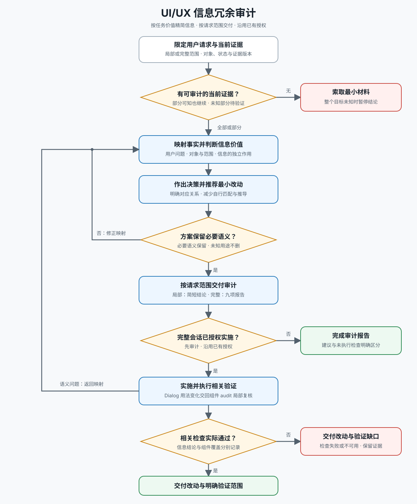

# UI/UX 信息冗余审计

交付：基于当前任务的信息价值审计结论；已授权时完成获准的最小改动与验证。

| 当前任务 | 读取 |
| --- | --- |
| 任何审查 | [工作流](references/workflow.md)：证据边界、信息映射、决策与交付规模 |
| 多状态、跨表面、条件变化、摘要关系或装饰与操作难以区分 | [模式与示例](references/redundancy-patterns.md) 的相关小节 |
| 已授权实施 | [实施与验证](references/implementation.md) |

用途未明的内容保留待验证；必要业务、安全、恢复与无障碍语义不能因精简丢失。

