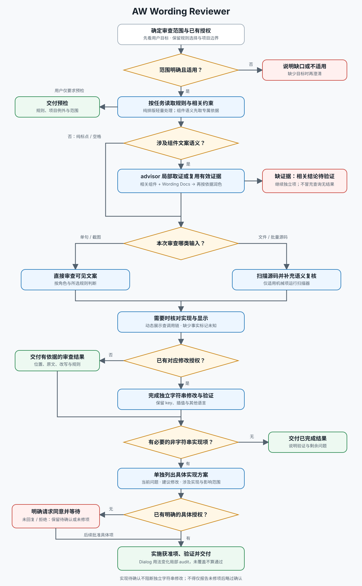

# AW Wording Reviewer

交付：有位置、规则依据和完整改写的简体中文文案审查结论；用户要求修改时，完成授权范围内的修改与验证。

先按 [文本工作流](references/workflow.md) 确定范围与完成条件，再按任务读取资料，不默认通读：

| 本次任务 | 所需资料 |
| --- | --- |
| 单句、粘贴片段或截图 | [规则索引](references/rules.md#按任务查找)及对应条目 |
| 指定规则、文件或批量中文词条 | 对应规则章节；源码扫描读 [扫描器用法](references/scanner.md) |
| 时间、周期或跨组件展示 | 规则集 D / H 相关条目；接入时读 [时间审查与接入](references/time-integration.md) |

默认只审查。字符串修改与渲染、格式化、组件配置等实现修改分开授权，见 [工作流第 4 节](references/workflow.md#4-按已有授权完成修改)。

